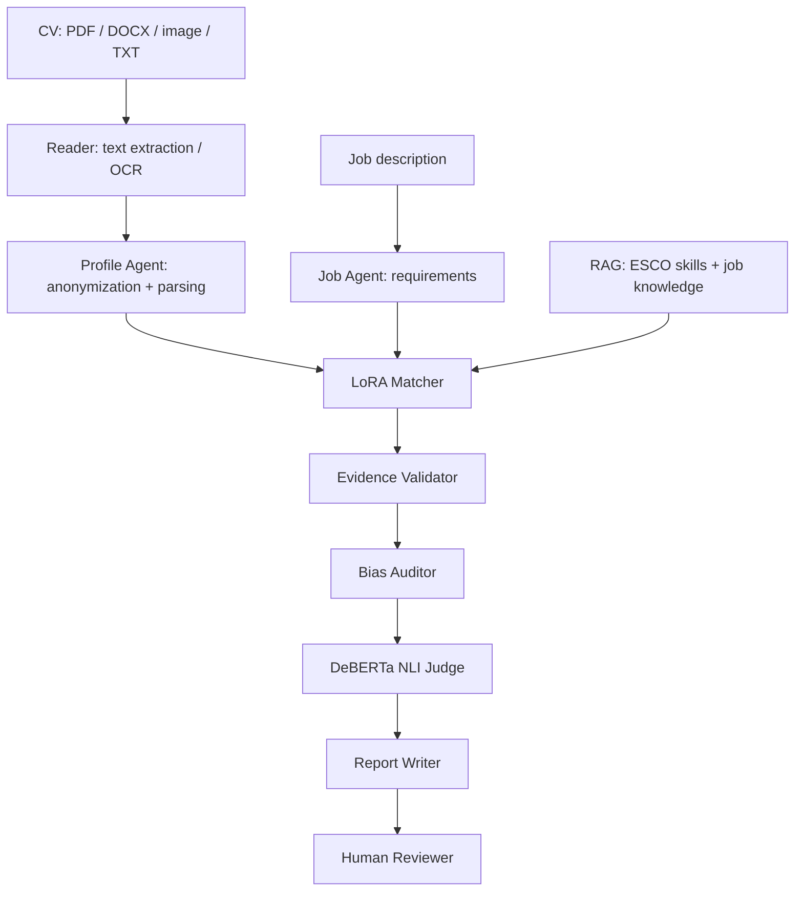

<div align="center">

# HireSignal

### Explainable, Multimodal & Multi-Agent AI Recruitment Screening

**ESPRIT · 5th-Year Data Science · Advanced Deep Learning · 2026–2027**

   

</div>

---

## Overview

**HireSignal** is an AI-assisted recruitment screening prototype that helps reviewers assess CVs against job descriptions using **verifiable evidence** rather than keyword matching alone. It brings together multimodal document reading, privacy-aware profile extraction, job requirement understanding, retrieval-augmented generation (RAG), LoRA-adapted matching, evidence verification, bias auditing, and explainable reports in one workflow.

> [!IMPORTANT]
> **Academic research prototype, not an automated hiring system.** Results such as **MET**, **MISSING**, and **UNCERTAIN** are aids for human review, not final employment decisions. Human reviewers must validate the evidence and make any hiring decisions.

**Contents:** [Features](#key-features) · [Architecture](#architecture) · [Tech stack](#ai-models--technology) · [Quick start](#quick-start-windows) · [API](#api) · [Validation](#testing--evaluation) · [Limitations](#known-limitations)

## Key Features

| Capability | Description |
| --- | --- |
| **Multimodal Reader** | Extracts information from PDF, DOCX, TXT and supported images, with optional Tesseract OCR for scans. |
| **Profile Agent** | Anonymizes identifying details and structures candidate information. |
| **Job Agent** | Extracts must-have and nice-to-have job requirements with supporting evidence. |
| **RAG + LoRA Matcher** | Evaluates each requirement using anonymized CV evidence with external skill knowledge as context. |
| **Evidence Validator** | Checks direct quotations, character spans, and consistency. |
| **Bias Auditor + NLI Judge** | Flags concerning or unsupported outcomes for independent human review. |
| **Explainable Reports** | Presents outcomes, evidence, provenance, and review reasons. |
| **Interactive Dashboard** | Displays candidates, processing stages, review workflows, and exportable results. |

## Architecture



### How it works

1. **Read:** Convert the CV into text, using OCR for scanned documents where configured.
2. **Understand:** Anonymize the CV and convert the job description into explicit requirements.
3. **Match:** Compare each requirement with **anonymized CV text**, supported by RAG knowledge.
4. **Verify:** Check quoted evidence, apply bias checks, and identify contradictions or unsupported claims.
5. **Report:** Deliver explanations and review flags to a human decision-maker.

**Evidence rule:** Skills returned by RAG or extracted into structured profile fields are *not proof* that a candidate has a skill. Matching evidence must come from the anonymized CV text. The V2 pipeline additionally flags certain prompt-injection patterns in untrusted documents.

## AI Models & Technology

| Layer | Current V2 implementation |
| --- | --- |
| Reader | PyMuPDF, python-docx, Pillow, optional Tesseract OCR |
| Profile / Job Agents | Qwen3-4B-Instruct-2507 (plain model) |
| Matcher | Qwen3-4B-Instruct-2507 + HireSignal LoRA |
| RAG | Gated RAG / BM25 over ESCO-derived skills and job data |
| Bias Auditor | Deterministic review and fairness rules |
| NLI Judge | `cross-encoder/nli-deberta-v3-xsmall` |
| Reporter | Qwen3-0.6B with deterministic report composition |
| Backend | Python, FastAPI, Pydantic, llama.cpp-compatible inference |
| Frontend | React, TypeScript, Vite, Tailwind CSS |

The Profile and Job Agents use plain Qwen3-4B, while the Matcher uses its LoRA variant. **Model weights and adapters are not included in the repository.**

## Quick Start (Windows)

### Prerequisites

The documented configuration targets **Windows 11, Python 3.12, Node.js 22.x**, and a prepared V1 virtual environment with cached model artifacts. Local tests were performed on an NVIDIA **RTX 4050 with 6 GB VRAM**. See [RUN_LOCAL.md](RUN_LOCAL.md) and the [V2 setup guide](docs/integration/V2_WINDOWS_RUN.md) for full model provisioning.

### 1. Clone

```powershell
git clone https://github.com/HireSignal-5DS-Team/HireSignal-5DS.git
cd HireSignal-5DS
```

### 2. Install V2 Reader packages

Using the existing V1 Python environment, install V2-only Reader dependencies into the Git-ignored `.v2deps` folder:

```powershell
& "C:\path\to\V1-repo\.venv\Scripts\python.exe" -m pip install --target .v2deps "pymupdf>=1.24" "python-docx>=1.1" "pytesseract>=0.3.10" "pillow>=10.0"
```

Replace the example V1 path with the location of your existing environment and model cache. Tesseract is installed separately if you need OCR for scanned PDFs and images.

### 3. Launch the complete V2 application

```powershell
.\scripts\start_v2_windows.ps1 -V1Repo "C:\path\to\V1-repo"
```

The launcher starts or reuses the model server, FastAPI backend and React frontend, checks readiness, installs missing frontend npm dependencies when needed, and opens the analysis page.

| Component | Default address |
| --- | --- |
| **Web interface** | http://127.0.0.1:5174/analysis |
| **Backend** | http://127.0.0.1:8001 |
| **API documentation** | http://127.0.0.1:8001/docs |
| **Model server** | http://127.0.0.1:8082/v1 |

V2 uses **8082 / 8001 / 5174**, keeping V1's **8081 / 8000 / 5173** ports separate.

To stop the V2 services:

```powershell
.\scripts\start_v2_windows.ps1 -Stop
```

For advanced configuration, GPU-layer limits and troubleshooting, read [V2_WINDOWS_RUN.md](docs/integration/V2_WINDOWS_RUN.md).

### Frontend-only mock demo

To explore the UI **without real model inference**:

```powershell
cd frontend
npm ci
npm run dev
```

This defaults to explicitly **MOCK** results. See [frontend/README.md](frontend/README.md).

## API

| Method | Endpoint | Purpose |
| --- | --- | --- |
| `GET` | `/health` | Liveness check |
| `GET` | `/ready` | Model, pipeline, and RAG readiness |
| `GET` | `/api/v1/models/status` | Model serving and provenance |
| `POST` | `/api/v1/match` | V1 structured matching |
| `POST` | `/api/v2/analyze` | V2 document and job analysis |

**Example:** Submit a text CV and a job description to the locally running real V2 backend:

```powershell
$body = @{
    cv_text = "Data analyst with Python and SQL project experience."
    job_text = "Python and SQL are required. Two years of experience is preferred."
} | ConvertTo-Json

Invoke-RestMethod -Uri "http://127.0.0.1:8001/api/v2/analyze" -Method Post -ContentType "application/json" -Body $body
```

For documents, use `cv_file_b64` and `cv_file_name` instead of `cv_text`. Uploaded CVs have a **10 MB** file limit. Results include stage information, matching decisions, review reasons, and report data. Consult the local `/docs` for the full schema.

## Testing & Evaluation

**Backend regression:**

```powershell
python -m pytest integration/tests/test_qwen_retry.py integration/tests/test_upstream.py integration/tests/test_api_v2.py
```

**Frontend validation:**

```powershell
cd frontend
npm ci
npm run test
npm run lint
npm run build
```

**Latest documented V2 validation — 22 October 2026:**

- **37 backend tests passed** in the V2 retry, upstream, and API suites.
- **30 frontend tests passed**, plus lint and production build.
- Two **fictional PDF candidates** completed a real local V2 pipeline run, both returning **HTTP 200**.
- These are **functional integration tests**, not measured hiring accuracy or proof of fairness.

See [V2 two-candidate GPU regression](docs/integration/V2_TWO_CANDIDATE_REPRO_20261022.md) for timing, model swaps, evidence, and unresolved findings.

## Repository Structure

```text
HireSignal-5DS/
├── agents/          # CV Reader, Profile and Job Agents
├── backend/         # FastAPI and progress reporting
├── integration/     # V2 orchestration and tests
├── matcher/         # LoRA Matcher, validation and pipeline
├── rag/             # Knowledge base and retrieval
├── bias/            # Audit and fairness checks
├── judge/           # NLI validation
├── reporter/        # Human-readable reporting
├── frontend/        # React app and tests
├── benchmark/       # Evaluation scripts
├── finetune/        # Model adaptation utilities
├── scripts/         # Startup scripts and CLI tools
└── docs/            # Architecture, guides and reports
```

## Known Limitations

- **Human oversight is required.** `MISSING` means requested evidence was not established, not that a candidate should be rejected.
- **Compound requirements** can be merged into one criterion by the Job Agent, making per-skill explanations less precise. Requirement atomization remains an open improvement.
- **Inference latency and transient upstream errors** may occur on a constrained local GPU. Some transient 5xx errors are handled by bounded retry, but full reliability is not guaranteed.
- **OCR performance** depends on document quality and Tesseract setup.
- **Prototype scope:** this project does not claim production-grade authentication, durable candidate storage, regulatory certification, or validated predictive hiring accuracy. CVs and exports must be treated as sensitive information.

## Documentation

| Resource | What it covers |
| --- | --- |
| [V2 Windows setup](docs/integration/V2_WINDOWS_RUN.md) | Installation, models, launcher and troubleshooting |
| [V1 local setup](RUN_LOCAL.md) | Original structured matching environment |
| [Latest V2 regression](docs/integration/V2_TWO_CANDIDATE_REPRO_20261022.md) | Real GPU test and open quality issues |
| [V2 integration report](docs/integration/V2_INTEGRATION_REPORT.md) | Historical integration snapshot; includes pre-merge notes |
| [Matcher architecture](docs/AGENT_PIPELINE.md) | Evidence validation and review workflow |
| [RAG documentation](rag/README.md) | Retrieval and skill knowledge |
| [Frontend documentation](frontend/README.md) | UI, mock demo, tests and deployment notes |

---

<div align="center">

**HireSignal · ESPRIT 5DS · Advanced Deep Learning · 2026–2027**

*Transparent, evidence-grounded and human-reviewed AI-assisted screening.*

</div>
